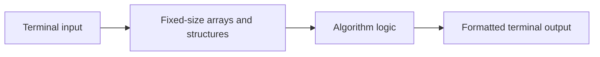

# OS Lab Experiments


A collection of operating system laboratory programs written in C. The repository implements classic algorithms for CPU scheduling, deadlock avoidance, memory allocation, page replacement, file management, and disk scheduling.

## Overview

Each experiment is a self-contained, single-file C program that reads its input from the terminal, runs one algorithm, and prints the result. The programs simulate operating system behavior in user space, which makes each algorithm's logic straightforward to read, trace, and run with custom inputs.

## Key Features

- 14 standalone programs covering the core topics of an operating systems laboratory course
- Per-process waiting time and turnaround time, with averages, for all four scheduling algorithms
- Safe-sequence detection using the Banker's Algorithm
- First Fit, Best Fit, and Worst Fit allocation with fragmentation reporting
- Frame-by-frame page replacement traces with page fault counts
- Menu-driven simulations for the bounded buffer and single-level directory programs
- No dependencies beyond a C compiler and the standard library

## Experiments

| Category | Program | Source File | Output |
| --- | --- | --- | --- |
| CPU Scheduling | First Come First Served | [`FCFS.c`](FCFS.c) | Waiting and turnaround times with averages |
| CPU Scheduling | Shortest Job First (non-preemptive) | [`SJF.c`](SJF.c) | Waiting and turnaround times with averages |
| CPU Scheduling | Round Robin | [`RoundRobin.c`](RoundRobin.c) | Waiting and turnaround times with averages |
| CPU Scheduling | Priority Scheduling (non-preemptive) | [`PriorityScheduling.c`](PriorityScheduling.c) | Execution order with waiting and turnaround times |
| Deadlock Avoidance | Banker's Algorithm | [`BankersAlgorithm.c`](BankersAlgorithm.c) | Safe sequence or unsafe state |
| Process Synchronization | Producer-Consumer | [`Producer-Consumer.c`](Producer-Consumer.c) | Interactive produce and consume operations |
| Memory Allocation | First Fit | [`First_Fit_Algo.c`](First_Fit_Algo.c) | Block assignment and internal fragmentation |
| Memory Allocation | Best Fit | [`Best_Fit_Algo.c`](Best_Fit_Algo.c) | Block assignment and internal fragmentation |
| Memory Allocation | Worst Fit | [`Worst_Fit_Algo.c`](Worst_Fit_Algo.c) | Block assignment and internal fragmentation |
| Page Replacement | FIFO | [`FIFO_Page_Replacement_Algo.c`](FIFO_Page_Replacement_Algo.c) | Frame states and page fault count |
| Page Replacement | Least Recently Used | [`LRU_Page_Replacement_Algorithm.c`](LRU_Page_Replacement_Algorithm.c) | Frame states and page fault count |
| File Organization | Single-Level Directory | [`Single_Level_Directory_File_Organization.c`](Single_Level_Directory_File_Organization.c) | Create, delete, search, and list files |
| File Allocation | Linked Allocation | [`Linked_File_Allocation.c`](Linked_File_Allocation.c) | Block allocation status |
| Disk Scheduling | SCAN | [`scan_disk_scheduling.c`](scan_disk_scheduling.c) | Seek sequence and total head movement |

## Technology Stack

| Component | Technology |
| --- | --- |
| Language | C |
| Compiler | GCC (any standard C compiler should work) |
| Libraries | C standard library (`stdio.h`, `stdlib.h`, `string.h`) |
| Interface | Terminal (standard input and output) |

## Architecture and Workflow

All programs follow the same structure: input is read from the terminal, the algorithm runs on fixed-size in-memory arrays, and the results are printed as a table or trace.



## Project Structure

```text
os-lab-experiments/
├── BankersAlgorithm.c
├── Best_Fit_Algo.c
├── FCFS.c
├── FIFO_Page_Replacement_Algo.c
├── First_Fit_Algo.c
├── LRU_Page_Replacement_Algorithm.c
├── Linked_File_Allocation.c
├── PriorityScheduling.c
├── Producer-Consumer.c
├── RoundRobin.c
├── SJF.c
├── Single_Level_Directory_File_Organization.c
├── Worst_Fit_Algo.c
├── scan_disk_scheduling.c
└── README.md
```

## Installation and Setup

### Prerequisites

- GCC or another C compiler

### Clone the Repository

```bash
git clone https://github.com/Partha-Shankar/os-lab-experiments.git
cd os-lab-experiments
```

### Compile a Program

```bash
gcc FCFS.c -o fcfs
```

To compile every program from a Bash shell:

```bash
for f in *.c; do gcc "$f" -o "${f%.c}"; done
```

## Usage

Run the compiled binary and enter the requested values at the prompts.

```bash
./fcfs          # Linux and macOS
.\fcfs.exe      # Windows
```

### Example: First Come First Served

Input: 3 processes with burst times 5, 3, and 8.

```text
Process	Burst Time	Waiting Time	Turnaround Time
1	5		0		5
2	3		5		8
3	8		8		16
Average Waiting Time: 4.33
Average Turnaround Time: 9.67
```

### Example: Banker's Algorithm

Input: 5 processes and 3 resources, using the maximum matrix `7 5 3, 3 2 2, 9 0 2, 2 2 2, 4 3 3`, the allocation matrix `0 1 0, 2 0 0, 3 0 2, 2 1 1, 0 0 2`, and available resources `3 3 2`.

```text
Safe Sequence: 2 4 1 3 5
```

### Example: SCAN Disk Scheduling

Input: disk size 200, requests `82 170 43 140 24 16 190`, current head 50, and previous request 40.

```text
SEEK SEQUENCE = 50 82 140 170 190 199 43 24 16
TOTAL DISTANCE: 348
```

## Technical Implementation

### CPU Scheduling

Burst times are stored in arrays, and waiting time is derived from the completed work of earlier processes. SJF and Priority Scheduling order processes with an in-place exchange sort. Round Robin tracks remaining burst time per process and cycles through them using the configured time quantum.

### Banker's Algorithm

The need matrix is computed as `Max - Allocation`. The program repeatedly selects an unfinished process whose need can be met by the available resources, releases that process's allocation, and records it in the safe sequence.

### Producer-Consumer

A menu-driven, single-threaded simulation of a bounded buffer. A 10-slot circular buffer uses `in` and `out` indices, and full and empty conditions are detected with modular arithmetic.

### Memory Allocation

Each strategy scans the free blocks for every request. First Fit takes the first block that is large enough, Best Fit takes the block leaving the smallest remainder, and Worst Fit takes the block leaving the largest remainder.

### Page Replacement

FIFO replaces pages in circular order using a single pointer. LRU records the most recent use of each page and evicts the resident page with the oldest reference.

### File Management

The single-level directory stores file names in one directory structure and supports create, delete, search, and list operations. The linked allocation program models a 50-block disk as an allocation table: starting from a chosen block, it assigns the requested number of free blocks and skips blocks that are already in use.

### SCAN Disk Scheduling

Requests are sorted together with the current head position and both disk ends, then split into upward and downward tracks. The direction of travel comes from comparing the previous request with the current head position.

## Scope and Assumptions

| Program | Input Range |
| --- | --- |
| FCFS, SJF, Round Robin, Priority | Up to 10 processes, all arriving at time zero |
| Priority Scheduling | A lower number means a higher priority |
| Banker's Algorithm | Up to 10 processes and 10 resource types |
| First Fit | Up to 24 blocks and 24 files |
| Best Fit | Up to 19 blocks and 19 processes |
| Worst Fit | Up to 10 blocks and 10 files |
| FIFO | Up to 49 page references and 10 frames |
| LRU | Up to 50 page references, with page numbers from 1 to 9 |
| Producer-Consumer | Holds up to 9 items at a time |
| Single-Level Directory | Up to 10 files, with names of up to 9 characters |
| Linked Allocation | Block numbers from 0 to 49 |
| SCAN | Up to 47 requests |

The memory allocation programs expect inputs where every request can be placed in an available block. Worst Fit expects a block strictly larger than each file.
